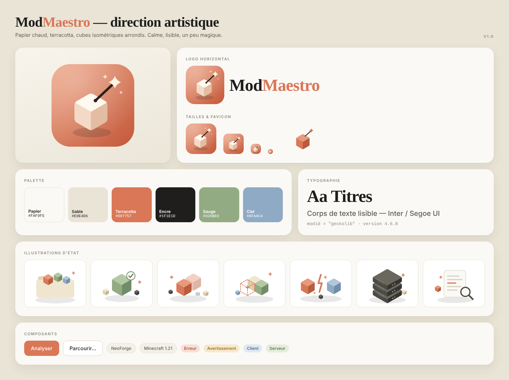

# ModMaestro — Direction artistique

> **Papier chaud, terracotta, cubes isométriques arrondis. Calme, lisible, un peu magique.**

Le chef d'orchestre ne joue d'aucun instrument : il fait en sorte que tout le monde joue ensemble.
C'est exactement le rôle de l'outil — d'où le **cube** (un mod / un bloc Minecraft) et la **baguette** (qui remet de l'ordre).

## Inspirations

| Source | Ce qu'on en retient |
|---|---|
| **Site de Claude** | Fond « papier » chaud plutôt que blanc froid, titres en serif, accent terracotta, beaucoup d'air |
| **Zen Browser** | Barre latérale qui flotte directement sur le fond, panneau principal arrondi et ombré, thème sombre doux |

## Logo

| Fichier | Usage |
|---|---|
| `assets/logo.svg` | Icône d'application (fond terracotta, coins arrondis) |
| `assets/logo-mark.svg` | Pictogramme seul, sans fond — à poser sur du clair |
| `assets/logo-lockup.svg` | Icône + « ModMaestro » (en-têtes, README) |
| `assets/logo-{16…512}.png`, `favicon.ico`, `apple-touch-icon.png` | Exports prêts à l'emploi |
| `assets/banner.svg / .png` | Bannière 1280×640 (dépôt GitHub, réseaux) |
| `assets/hero.svg / .png` | Scène isométrique de l'écran d'accueil |

**Règles** : garder une zone de respect d'un demi-cube autour du logo ; ne jamais étirer, tourner ni recolorer le cube ;
sur fond sombre, utiliser `logo.svg` (le fond terracotta garantit le contraste).
Le nom s'écrit **Mod** (encre) + **Maestro** (terracotta), en serif, sans espace.

## Couleurs

| Rôle | Nom | Clair | Sombre |
|---|---|---|---|
| Fond de fenêtre | Sable | `#E9E4D6` | `#161513` |
| Panneau | Papier | `#FAF9F5` | `#201F1C` |
| Texte | Encre | `#1F1E1D` | `#F1EEE6` |
| Accent | Terracotta | `#D97757` | `#E08A6A` |
| Succès / « serveur » | Sauge | `#5E7A52` | `#A5C093` |
| Avertissement | Ocre | `#A9701F` | `#E0B25E` |
| Erreur | Brique | `#BC4A33` | `#EE8D78` |
| Info / « client » | Ciel | `#4C6E91` | `#9DBBDB` |

Les couleurs d'état ont toujours un **fond doux** (`*-soft`) + un texte plein : on ne s'appuie jamais sur la couleur seule
(chaque état a aussi une icône et un libellé).

## Typographie

- **Titres** : serif système — *Iowan Old Style → Palatino → Georgia*. Poids 600, interlettrage serré (−1 à −2 %).
- **Interface** : *Inter → Segoe UI → system-ui*.
- **Données** (identifiants, chemins, versions) : monospace système.

Aucune police n'est téléchargée : l'outil fonctionne hors ligne et reste rapide.

## Formes & mouvement

- Rayons : 22 px (panneaux) · 14 px (cartes) · 10–12 px (boutons, champs) · pilule pour les puces.
- Ombres larges et très douces, teintées chaud ; jamais de noir pur.
- Cubes isométriques à angle de 30°, coins arrondis (≈ 13 % de l'arête), trois teintes par couleur (dessus clair, face gauche moyenne, face droite foncée).
- Mouvement : 120–200 ms, ease-out ; l'anneau de score s'anime en 0,8 s. Tout est coupé si l'utilisateur demande « réduire les animations ».

## Illustrations d'état

Un même vocabulaire (cubes + petite étincelle terracotta + ombre au sol) pour tous les écrans vides :

| Fichier | Situation |
|---|---|
| `welcome.svg` | Accueil / dossier à choisir |
| `ok.svg` | Tout est propre |
| `duplicates.svg` | Doublons |
| `missing.svg` | Dépendance manquante (cube en pointillés) |
| `conflict.svg` | Incompatibilité (éclair entre deux cubes) |
| `server.svg` | Dossier serveur |
| `logs.svg` | Analyse de journal |

Tout est généré par `tools/make_assets.py` (SVG + PNG + `.ico`) : modifier la palette en haut du script puis le relancer
régénère l'ensemble de l'identité d'un coup.

## Ton de voix

Tutoiement, phrases courtes, verbes d'action. On explique **pourquoi** puis **quoi faire** :

- ✅ « Deux versions de GeckoLib sont installées : le jeu refuse de démarrer. Garde la 4.6.0. »
- ❌ « Erreur de résolution de modid dupliqué. »

Jamais d'alarmisme : « Ce modpack ne démarrera probablement pas » plutôt que « ÉCHEC CRITIQUE ».
