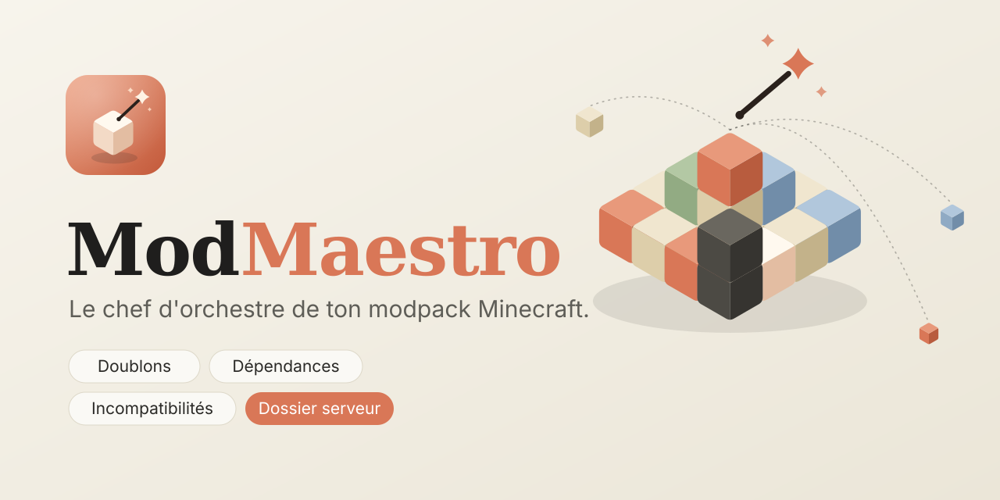
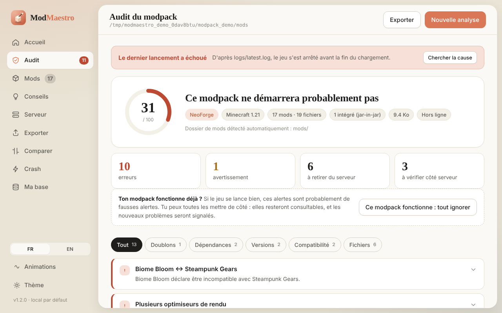

<p align="center"></p>

# ModMaestro

Audit your Minecraft modpack, find the mod that crashes it, compare two packs, and build an optimised server — with a local web interface (French / English), a terminal menu, or one-line commands.
*Audite ton modpack Minecraft, trouve le mod qui le fait planter, compare deux packs et prépare un serveur optimisé — interface web locale (français / anglais), menu terminal ou simples commandes.*

[🇫🇷 Français](#-français) · [🇬🇧 English](#-english)



---

## 🇫🇷 Français

### À propos

ModMaestro lit chaque `.jar` d'un dossier `mods`, explique en clair ce qui cloche et comment le réparer, puis prépare ce qu'il faut pour un serveur dédié. Il est **local par défaut** : rien ne quitte ton ordinateur sans que tu l'actives.

Compatible **NeoForge, Forge, Fabric et Quilt**, y compris les mods embarqués (jar-in-jar) et les passerelles comme Sinytra Connector.

### Fonctionnalités

**Analyse**
* **Doublons, dépendances, versions** : plusieurs versions d'un même mod, mods requis manquants, plages de versions non respectées (Maven, Fabric, `~`, `^`, `1.21.x`).
* **Incompatibilités** : conflits déclarés par les auteurs et pièges connus (Sodium + OptiFine, deux moteurs de shaders…).
* **Compatibilité loader / Minecraft**, fichiers corrompus ou sans métadonnées, tri **client / serveur**.
* **Score de santé fiable** : chaque alerte est *certaine* ou *probable* ; seules les certaines pèsent lourd, et le score ne s'effondre plus à cause d'une cascade d'estimations. Si `logs/latest.log` prouve que le jeu a démarré, le pack n'est **jamais** déclaré cassé. Une fausse alerte se met de côté en un clic (« Ignorer »), ou toutes d'un coup (« Ce modpack fonctionne : tout ignorer ») ; elles restent consultables et réversibles.
* **Modrinth** *(facultatif, désactivé par défaut)* : reconnaît les mods par empreinte, fiabilise le tri client / serveur, ajoute incompatibilités et mises à jour. Cache SQLite local.

**Outils**
* **Comparer 2 modpacks** : mods ajoutés, retirés, mis à jour ou rétrogradés, et problèmes apparus ou résolus, avec l'évolution du score.
* **Chercher la cause d'un crash** : lecture de `latest.log` / crash-report (dépendance manquante, mixin, Java, mémoire…), puis, si le journal ne dit rien, **recherche par essais** : ModMaestro prépare des dossiers de test (avec les dépendances nécessaires), tu lances le jeu et réponds « ça plante » / « ça marche ». Le suspect est confirmé par un contre-essai.
* **Exporter** : `.mrpack` (Modrinth, Prism, ATLauncher…), archive `.zip`, **rapport HTML** à envoyer à des amis (liste propre des mods et des problèmes, aucun chemin de ton ordinateur par défaut) ou rapport Markdown.
* **Dossier serveur** : copie des mods utiles vers un dossier **neuf** ; ton dossier d'origine n'est jamais modifié. Chaque choix est modifiable.
* **Fichiers de lancement optimisés** : `start.bat` / `start.sh`, `user_jvm_args.txt`, `server.properties`. Java choisi d'après la version de Minecraft, flags d'Aikar, mémoire estimée, redémarrage automatique, adaptés à NeoForge, Forge, Fabric ou Quilt. `eula.txt` reste à `false` tant que tu n'as pas coché l'acceptation toi-même.
* **Mods conseillés** : compagnons connus pour que les autres mods marchent mieux (performances, correctifs de crash, bibliothèques), avec disponibilité pour ta version si Modrinth est activé.
* **Ma base** : un conflit ou un mod client découvert s'enregistre dans ta base personnelle, s'applique à toutes tes analyses et s'exporte / s'importe. Le bouton **Proposer à la communauté** prépare un message prêt à publier sur le dépôt du projet.

**Interface**
* **Français / anglais** (sélecteur en bas du menu ; les alertes, rapports et le terminal suivent la langue) et animations douces, désactivables (réglage « Animations » ; `prefers-reduced-motion` est respecté).
* Thème clair / sombre, adaptée aux petits écrans.

### Installation et lancement

**Sans Python** : télécharge l'application pour ton système dans les [Releases](../../releases) (`ModMaestro-Windows-x64.zip`, `ModMaestro-Linux-x64.tar.gz`, `ModMaestro-macOS-arm64.zip` ou `-x64.zip`), décompresse et lance `ModMaestro`. Elle ouvre l'interface dans ton navigateur. *(Non signée : Windows SmartScreen et macOS Gatekeeper demandent une confirmation au premier lancement.)*

**Avec Python 3.11+** ([python.org](https://www.python.org/downloads/)) :

| Système | Lancement |
|---|---|
| Windows | double-clic sur `lancer.bat` |
| Linux / macOS | `./lancer.sh` |
| Partout | `python main.py` |

```bash
python main.py "/chemin/vers/mods"                     # interface web, analyse lancée
python main.py --lang en --demo                        # essayer avec un modpack fictif, en anglais
python main.py --cli                                   # menu interactif dans le terminal
python main.py --audit "/mods" [--online]              # audit rapide ; code retour 1 s'il y a des erreurs
python main.py --compare "/pack_avant" "/pack_apres"   # compare deux modpacks
python main.py --html rapport.html "/mods"             # rapport HTML à partager
python main.py --export-mrpack pack.mrpack "/mods" --loader-version 21.1.172
python main.py --server-kit "/nouveau/dossier" "/mods" --ram 8 [--accept-eula]
python main.py --find-crash "/mods"                    # recherche du mod fautif par essais
python main.py --recommend "/mods"                     # mods conseillés
python main.py --kb | --export-kb f.json | --import-kb f.json   # ta base personnelle
```

Le dossier peut être le dossier `mods`, la racine d'une instance (le dossier `mods/` est trouvé tout seul, y compris pour Prism ou MultiMC) ou un `.zip` qui contient un dossier `mods/`.

**Compiler soi-même** : `pip install pyinstaller rich`, puis `python tools/build_binaries.py` → `dist/ModMaestro`. PyInstaller ne compile que pour le système sur lequel il tourne ; le workflow GitHub Actions (`.github/workflows/build.yml`) produit Windows, Linux et macOS : il lance les tests, vérifie que chaque exécutable démarre, puis publie les fichiers dans une Release quand tu pousses un tag `vX.Y.Z`.

### Limites

* Le tri client / serveur est une **estimation** ; en cas de doute le mod est marqué « à vérifier » et gardé.
* Les conflits que personne ne déclare ne se voient qu'au lancement : d'où le journal de crash et la recherche par essais (elle suppose que le crash est reproductible et demande de relancer le jeu à chaque essai).
* Modrinth ne connaît que les mods qui y sont publiés (pas CurseForge). Un `.mrpack` référence les mods reconnus et embarque les autres.
* Le lanceur serveur suppose que tu as installé le serveur (Forge / NeoForge / Fabric / Quilt) dans le dossier ; ModMaestro génère les scripts, pas l'installation du loader.
* Les exécutables Windows et macOS sont compilés par GitHub Actions ; seul le build Linux a été essayé à la main.
* La base communautaire fournie est un **point de départ** : elle ne grandit que si tu y contribues.

### Confidentialité et sécurité

**Par défaut, rien ne quitte ton ordinateur.** Si tu actives Modrinth (interrupteur de l'accueil ou `--online`), ModMaestro envoie à `api.modrinth.com` **uniquement l'empreinte SHA-1 de chaque `.jar`**, puis des identifiants de projets : jamais les noms de fichiers, chemins ou ta base. Le message « Proposer à la communauté » ne part jamais seul : tu le publies toi-même. Le rapport HTML n'inclut aucun chemin par défaut.

Cache et base personnelle : `%APPDATA%\ModMaestro` (Windows), `~/Library/Application Support/ModMaestro` (macOS) ou `~/.local/share/modmaestro` (Linux) ; variable `MODMAESTRO_HOME` pour en changer. Variables utiles : `MODMAESTRO_CONTACT` (lien GitHub demandé par Modrinth), `MODMAESTRO_REPO` (dépôt visé par « Proposer à la communauté »), `MODMAESTRO_MODRINTH_URL`, `MODMAESTRO_LANG`.

Le serveur de l'interface n'écoute que sur `127.0.0.1`, vérifie `Host` et `Origin`, et exige un jeton aléatoire par lancement.

### Structure

```
modmaestro/
├── main.py                  point d'entrée : web, menu terminal, commandes
├── ModMaestro.spec          PyInstaller · tools/build_binaries.py · .github/workflows/build.yml
├── core/
│   ├── parser, versions, analyzer, builder, logscan, report, demo   moteur d'analyse
│   ├── pipeline.py          analyse complète (locale ou avec Modrinth)
│   ├── compare.py · crashfinder.py · export.py · serverkit.py · recommend.py
│   ├── htmlreport.py · contribute.py · learn.py · knowledge.py
│   ├── modrinth.py · cache.py · enrich.py          Modrinth + cache SQLite
│   ├── i18n.py · i18n_en.py · en/                  traductions (le texte français sert de clé)
│   └── data/                knowledge.json, recommendations.json, community/
├── web/                     serveur local + interface (static/i18n/en.json = anglais)
├── tools/                   check_community.py · check_i18n_js.py · make_assets.py · build_binaries.py
├── tests/                   python -I -m unittest discover -s tests
├── assets/ · docs/ · BRAND.md
```

### Contribuer

* **Mod client ou conflit connu** (aucun code) : crée `core/data/community/sides/<modid>.json` ou `conflicts/<a>__<b>.json` (format dans `core/data/community/README.md`), ou utilise « Proposer à la communauté ». Vérifie avec `python tools/check_community.py`, puis ouvre une pull request **avec la source** (log, page Modrinth, issue…).
* **Mod conseillé** : une règle dans `core/data/recommendations.json` (avec `why` et `why_en`).
* **Traduction** : le français est la clé. Textes Python : `core/en/*.py` ; interface : `web/static/i18n/en.json`. `python -I -m unittest discover -s tests` et `python tools/check_i18n_js.py` signalent tout texte non traduit.

### Licence

Outil public, sous licence **MIT** (voir `LICENSE`).

---

## 🇬🇧 English

### Overview

ModMaestro reads every `.jar` in a `mods` folder, explains what is wrong in plain language and how to fix it, and prepares what a dedicated server needs. It is **local by default**: nothing leaves your computer unless you turn it on.

It supports **NeoForge, Forge, Fabric and Quilt**, including bundled mods (jar-in-jar) and bridges such as Sinytra Connector.

### Features

**Analysis**
* **Duplicates, dependencies, versions**: several versions of one mod, missing required mods, unmet version ranges (Maven, Fabric, `~`, `^`, `1.21.x`).
* **Incompatibilities**: conflicts declared by authors and well-known traps (Sodium + OptiFine, two shader engines…).
* **Loader / Minecraft compatibility**, corrupted or metadata-less files, **client / server** split.
* **A health score you can trust**: every alert is *certain* or *likely*; only certain ones weigh heavily, and a cascade of estimates no longer collapses the score. If `logs/latest.log` proves the game booted, the pack is **never** called broken. A false alert can be set aside in one click ("Ignore"), or all at once ("This modpack works: ignore all"); they stay visible and reversible.
* **Modrinth** *(optional, off by default)*: identifies mods by hash, makes the client / server split reliable, adds incompatibilities and updates. Local SQLite cache.

**Tools**
* **Compare 2 modpacks**: mods added, removed, updated or downgraded, plus new and fixed problems, with the score change.
* **Crash cause finder**: reads `latest.log` / crash reports (missing dependency, mixin, Java, memory…), then, when the log says nothing, a **trial search**: ModMaestro builds test folders (dependencies included), you launch the game and answer "crashes" / "works". The suspect is confirmed with a counter-trial.
* **Export**: `.mrpack` (Modrinth, Prism, ATLauncher…), `.zip` archive, **HTML report** to send to friends (clean mod and problem lists, no path from your computer by default) or Markdown report.
* **Server folder**: copies the useful mods to a **new** folder; your original folder is never modified. Every choice can be changed.
* **Optimised launch files**: `start.bat` / `start.sh`, `user_jvm_args.txt`, `server.properties`. Java picked from the Minecraft version, Aikar's flags, estimated memory, auto-restart, adapted to NeoForge, Forge, Fabric or Quilt. `eula.txt` stays `false` until you tick the acceptance yourself.
* **Suggested mods**: well-known companions that make your other mods work better (performance, crash fixes, libraries), with availability for your version when Modrinth is on.
* **My base**: a conflict or client-only mod you discover is saved to your personal base, applied to every analysis, and can be exported / imported. **Suggest to the community** prepares a message ready to post on the project repository.

**Interface**
* **French / English** (selector at the bottom of the menu; alerts, reports and the terminal follow the language) and gentle animations you can turn off ("Animations" setting; `prefers-reduced-motion` is respected).
* Light / dark theme, works on small screens.

### Install and Run

**Without Python**: download the app for your system from [Releases](../../releases) (`ModMaestro-Windows-x64.zip`, `ModMaestro-Linux-x64.tar.gz`, `ModMaestro-macOS-arm64.zip` or `-x64.zip`), unpack and run `ModMaestro`. It opens the interface in your browser. *(Unsigned: Windows SmartScreen and macOS Gatekeeper ask for confirmation on first launch.)*

**With Python 3.11+** ([python.org](https://www.python.org/downloads/)):

| System | Launch |
|---|---|
| Windows | double-click `lancer.bat` |
| Linux / macOS | `./lancer.sh` |
| Anywhere | `python main.py` |

```bash
python main.py "/path/to/mods"                         # web interface, analysis started
python main.py --lang en --demo                        # try it with a fake modpack, in English
python main.py --cli                                   # interactive terminal menu
python main.py --audit "/mods" [--online]              # quick audit; exit code 1 if there are errors
python main.py --compare "/pack_before" "/pack_after"  # compare two modpacks
python main.py --html report.html "/mods"              # shareable HTML report
python main.py --export-mrpack pack.mrpack "/mods" --loader-version 21.1.172
python main.py --server-kit "/new/folder" "/mods" --ram 8 [--accept-eula]
python main.py --find-crash "/mods"                    # trial search for the faulty mod
python main.py --recommend "/mods"                     # suggested mods
python main.py --kb | --export-kb f.json | --import-kb f.json   # your personal base
```

The folder can be the `mods` folder, an instance root (the `mods/` folder is found automatically, Prism and MultiMC included) or a `.zip` containing a `mods/` folder.

**Build it yourself**: `pip install pyinstaller rich`, then `python tools/build_binaries.py` → `dist/ModMaestro`. PyInstaller only builds for the system it runs on; the GitHub Actions workflow (`.github/workflows/build.yml`) produces Windows, Linux and macOS: it runs the tests, checks that each executable starts, and publishes them to a Release when you push a `vX.Y.Z` tag.

### Limitations

* The client / server split is an **estimate**; when unsure the mod is marked "to check" and kept.
* Conflicts nobody declares only show at launch: hence the crash log and the trial search (it needs a reproducible crash and a game restart for each trial).
* Modrinth only knows mods published there (not CurseForge). A `.mrpack` references recognised mods and embeds the others.
* The server launcher assumes you installed the server (Forge / NeoForge / Fabric / Quilt) in the folder; ModMaestro generates the scripts, not the loader installation.
* Windows and macOS executables are built by GitHub Actions; only the Linux build was tried by hand.
* The bundled community base is a **starting point**: it only grows if you contribute.

### Privacy and Security

**By default nothing leaves your computer.** If you turn on Modrinth (home-page switch or `--online`), ModMaestro sends `api.modrinth.com` **only the SHA-1 hash of each `.jar`**, then project ids: never file names, paths or your base. The "Suggest to the community" message is never sent by itself: you post it yourself. The HTML report contains no path by default.

Cache and personal base: `%APPDATA%\ModMaestro` (Windows), `~/Library/Application Support/ModMaestro` (macOS) or `~/.local/share/modmaestro` (Linux); set `MODMAESTRO_HOME` to change it. Useful variables: `MODMAESTRO_CONTACT` (GitHub link Modrinth asks for), `MODMAESTRO_REPO` (repository targeted by "Suggest to the community"), `MODMAESTRO_MODRINTH_URL`, `MODMAESTRO_LANG`.

The interface server only listens on `127.0.0.1`, checks `Host` and `Origin`, and requires a random token per launch.

### Contributing

* **Client-only mod or known conflict** (no code): create `core/data/community/sides/<modid>.json` or `conflicts/<a>__<b>.json` (format in `core/data/community/README.md`), or use "Suggest to the community". Check with `python tools/check_community.py`, then open a pull request **with the source** (log, Modrinth page, issue…).
* **Suggested mod**: add a rule to `core/data/recommendations.json` (with `why` and `why_en`).
* **Translation**: French is the key. Python texts: `core/en/*.py`; interface: `web/static/i18n/en.json`. `python -I -m unittest discover -s tests` and `python tools/check_i18n_js.py` flag any untranslated text.

### License

Public tool under the **MIT** license (see `LICENSE`).
