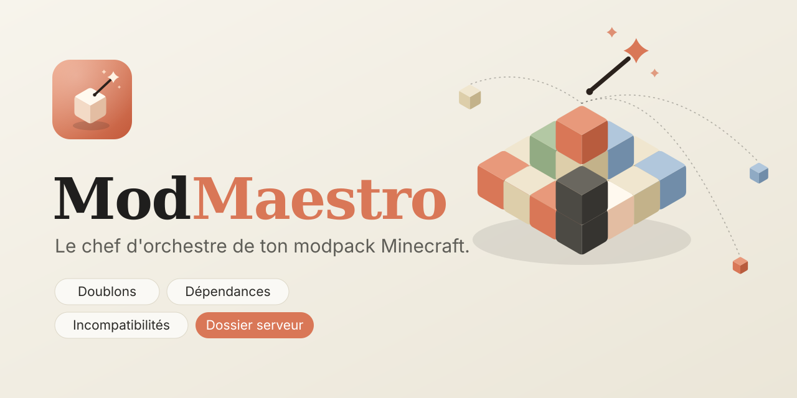
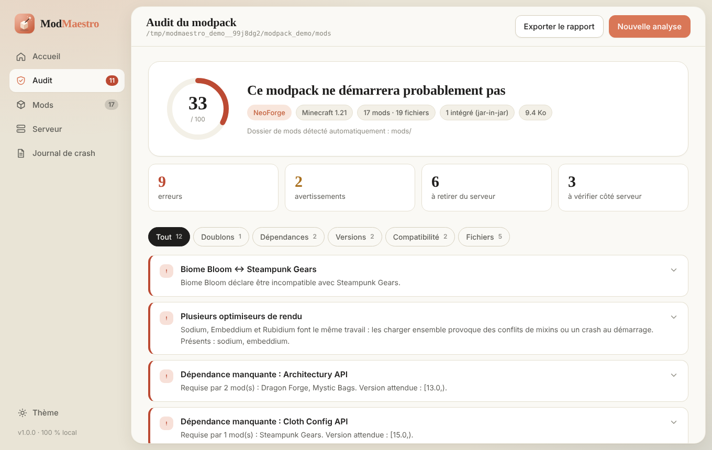

<p align="center"></p>

# ModMaestro

Audit your Minecraft modpack, find the mod that crashes it, compare two packs, and build an optimised server — with a local web interface (French / English), a terminal menu, or one-line commands.
*Audite ton modpack Minecraft, trouve le mod qui le fait planter, compare deux packs et prépare un serveur optimisé — interface web locale (français / anglais), menu terminal ou simples commandes.*

[🇫🇷 Français](#-français) · [🇬🇧 English](#-english)



---

## 🇫🇷 Français

### À propos

ModMaestro lit chaque `.jar` d'un dossier `mods`, explique en clair ce qui cloche et comment le réparer, puis prépare ce qu'il faut pour un serveur dédié. Il est **local par défaut** : rien ne quitte ton ordinateur sans que tu l'actives.

Compatible **NeoForge, Forge, Fabric et Quilt**, y compris les mods embarqués (jar-in-jar) et les passerelles comme Sinytra Connector.

### Fonctionnalités

**Analyse**
* **Doublons, dépendances, versions** : plusieurs versions d'un même mod, mods requis manquants, plages de versions non respectées (Maven, Fabric, `~`, `^`, `1.21.x`).
* **Incompatibilités** : conflits déclarés par les auteurs et pièges connus (Sodium + OptiFine, deux moteurs de shaders…).
* **Compatibilité loader / Minecraft**, fichiers corrompus ou sans métadonnées, tri **client / serveur**.
* **Score de santé fiable** : chaque alerte est *certaine* ou *probable* ; seules les certaines pèsent lourd, et le score ne s'effondre plus à cause d'une cascade d'estimations. Si `logs/latest.log` prouve que le jeu a démarré, le pack n'est **jamais** déclaré cassé. Une fausse alerte se met de côté en un clic (« Ignorer »), ou toutes d'un coup (« Ce modpack fonctionne : tout ignorer ») ; elles restent consultables et réversibles.
* **Modrinth** *(facultatif, désactivé par défaut)* : reconnaît les mods par empreinte, fiabilise le tri client / serveur, ajoute incompatibilités et mises à jour. Cache SQLite local.

**Outils**
* **Comparer 2 modpacks** : mods ajoutés, retirés, mis à jour ou rétrogradés, et problèmes apparus ou résolus, avec l'évolution du score.
* **Chercher la cause d'un crash** : lecture de `latest.log` / crash-report (dépendance manquante, mixin, Java, mémoire…), puis, si le journal ne dit rien, **recherche par essais** : ModMaestro prépare des dossiers de test (avec les dépendances nécessaires), tu lances le jeu et réponds « ça plante » / « ça marche ». Le suspect est confirmé par un contre-essai.
* **Exporter** : `.mrpack` (Modrinth, Prism, ATLauncher…), archive `.zip`, **rapport HTML** à envoyer à des amis (liste propre des mods et des problèmes, aucun chemin de ton ordinateur par défaut) ou rapport Markdown.
* **Dossier serveur** : copie des mods utiles vers un dossier **neuf** ; ton dossier d'origine n'est jamais modifié. Chaque choix est modifiable.
* **Fichiers de lancement optimisés** : `start.bat` / `start.sh`, `user_jvm_args.txt`, `server.properties`. Java choisi d'après la version de Minecraft, flags d'Aikar, mémoire estimée, redémarrage automatique, adaptés à NeoForge, Forge, Fabric ou Quilt. `eula.txt` reste à `false` tant que tu n'as pas coché l'acceptation toi-même.
* **Mods conseillés** : compagnons connus pour que les autres mods marchent mieux (performances, correctifs de crash, bibliothèques), avec disponibilité pour ta version si Modrinth est activé.
* **Ma base** : un conflit ou un mod client découvert s'enregistre dans ta base personnelle, s'applique à toutes tes analyses et s'exporte / s'importe. Le bouton **Proposer à la communauté** prépare un message prêt à publier sur le dépôt du projet.
* **Ce diagnostic est faux** : sur chaque alerte, un clic prépare un rapport **anonyme** (type d'alerte, identifiants des mods, loader, version de Minecraft, ta note — jamais de chemin ni de nom de fichier). Tu le relis, puis tu le publies toi-même ; tu peux aussi ignorer l'alerte au passage.
* **Mettre à jour la base communautaire** (page *Ma base*) : un bouton télécharge les nouvelles entrées du dépôt GitHub du projet (`core/data/community/`). Uniquement des fichiers JSON de données, chacun validé ; rangés dans le dossier ModMaestro, jamais dans tes mods ; réversible (« Retirer les mises à jour »). Jamais en arrière-plan.
* **Vérifier les mises à jour** (bas du menu) : un clic cherche s'il existe une Release plus récente sur GitHub et te donne le lien de téléchargement. Rien n'est téléchargé ni installé automatiquement.
* **Glisser-déposer** : dépose un dossier (mods ou instance), des `.jar`, un `.zip` ou un `.mrpack` dans la fenêtre. Le navigateur ne donne pas les chemins : ModMaestro reçoit uniquement les `.jar`, `logs/latest.log` ou l'archive, dans un dossier temporaire supprimé à la fermeture. Ton dossier d'origine n'est jamais modifié.
* **Import direct d'un modpack** : choisis ou dépose un `.mrpack` ou un zip CurseForge, sans le décompresser. Les `.jar` embarqués sont lus directement ; pour un `.mrpack`, les mods listés sont téléchargés **seulement si l'option Modrinth est activée** (hébergeurs officiels uniquement, chaque fichier vérifié par son empreinte). Un zip CurseForge ne liste que des numéros de projet (clé d'API requise) : seuls ses `.jar` embarqués sont analysés, et l'interface te le dit. Les dossiers temporaires sont supprimés à la fermeture.
* **Analyse des fichiers de configuration** : ModMaestro lit (sans rien modifier) `server.properties`, `options.txt`, `user_jvm_args.txt` / scripts de lancement à côté du dossier `mods/` et signale les réglages connus pour causer des lags ou des crashs (distances trop grandes, `-Xmx` trop haut ou trop bas, deux ramasse-miettes en même temps, watchdog coupé…). Ce sont des **suggestions** (onglet *Configuration*), jamais des erreurs. Tu peux ajouter tes règles pour un mod dans `<dossier ModMaestro>/configrules/*.json` (format : `core/data/configrules.json`, champs `id`, `path` dans `config/`, `key`, `op` = `eq/ne/gt/ge/lt/le/true/false/contains`, `value`, `severity`, `title`, `message`, `fix`, option `requires_mod`).
* **Lecture fine des crashs** : dans l'onglet *Crash*, ModMaestro relie la pile d'erreur au mod fautif même quand son nom n'apparaît pas : section « Suspected Mods », nom du `.jar` cité dans la pile, module `monmod@1.0/`, paquet de la classe retrouvé dans les `.jar` installés, méthodes injectées par un mixin. Chaque suspect a un niveau de confiance (sûr / probable / possible) et ses preuves ; la cause racine (« Caused by ») pèse le plus. Un mod présent dans la pile n'est pas forcément coupable : « Trouver le mod fautif » reste la preuve.
* **Surveillance de serveur** (onglet *Surveillance*) : ModMaestro suit `logs/latest.log` d'un serveur en cours (lecture seule, relève toutes les 2,5 s, lignes nouvelles seulement) et signale : un mod qui produit des erreurs (par le nom de l'enregistreur ou la pile d'erreur ; alerte dès 5 erreurs, aggravée à 25), « Can't keep up », tick très long, manque de mémoire, redémarrage. Notifications du navigateur en option. Rien n'est envoyé nulle part.
* **Mise à jour des mods** (onglet *Mises à jour*, nécessite l'option Modrinth) : liste les mods qui ont une version plus récente pour ton loader et ta version de Minecraft, les télécharge (hébergeur officiel Modrinth, empreinte vérifiée), assemble un pack de test et le ré-analyse : chaque mise à jour est marquée « sans problème » ou « à risque » (dépendance manquante, conflit…). Le résultat est écrit dans un **nouveau dossier** après un test obligatoire : ton dossier de mods n'est jamais modifié.
* **Application de bureau** : avec `pywebview` (`pip install pywebview`) ou avec les exécutables Windows / macOS, l'interface s'ouvre dans une fenêtre d'application (icône, taille mémorisée par le système) au lieu du navigateur. Les rapports s'enregistrent par la boîte « Enregistrer sous » du système, les liens s'ouvrent dans ton navigateur. Si la fenêtre ne peut pas s'ouvrir, ModMaestro bascule seul sur le navigateur ; `--browser` force le navigateur, `--no-browser` ne lance que le serveur local. **Mise à jour facile** : le bouton « Vérifier les mises à jour » propose le fichier de ton système ; ta base personnelle et tes réglages sont conservés (ils vivent hors de l'application).

**Interface**
* **Français / anglais** (sélecteur en bas du menu ; les alertes, rapports et le terminal suivent la langue) et animations douces, désactivables (réglage « Animations » ; `prefers-reduced-motion` est respecté).
* Thème clair / sombre, adaptée aux petits écrans.

### Installation et lancement

**Sans Python** : télécharge l'application pour ton système dans les [Releases](../../releases) (`ModMaestro-Windows-x64.zip`, `ModMaestro-Linux-x64.tar.gz`, `ModMaestro-macOS-arm64.zip`, Mac Apple Silicon uniquement), décompresse et lance `ModMaestro`. Sous Windows et macOS elle s'ouvre dans sa **propre fenêtre** ; sous Linux (et si la fenêtre ne peut pas s'ouvrir) elle utilise ton navigateur. *(Non signée : Windows SmartScreen et macOS Gatekeeper demandent une confirmation au premier lancement.)*

**Avec Python 3.11+** ([python.org](https://www.python.org/downloads/)) :

| Système | Lancement |
|---|---|
| Windows | double-clic sur `lancer.bat` |
| Linux / macOS | `./lancer.sh` |
| Partout | `python main.py` |

```bash
python main.py "/chemin/vers/mods"                     # interface web, analyse lancée
python main.py --lang en --demo                        # essayer avec un modpack fictif, en anglais
python main.py --cli                                   # menu interactif dans le terminal
python main.py --audit "/mods" [--online]              # audit rapide ; code retour 1 s'il y a des erreurs
python main.py --compare "/pack_avant" "/pack_apres"   # compare deux modpacks
python main.py --html rapport.html "/mods"             # rapport HTML à partager
python main.py --export-mrpack pack.mrpack "/mods" --loader-version 21.1.172
python main.py --server-kit "/nouveau/dossier" "/mods" --ram 8 [--accept-eula]
python main.py --find-crash "/mods"                    # recherche du mod fautif par essais
python main.py --recommend "/mods"                     # mods conseillés
python main.py --kb | --export-kb f.json | --import-kb f.json   # ta base personnelle
```

Le dossier peut être le dossier `mods`, la racine d'une instance (le dossier `mods/` est trouvé tout seul, y compris pour Prism ou MultiMC) ou un `.zip` qui contient un dossier `mods/`.

**Compiler soi-même** : `pip install pyinstaller rich`, puis `python tools/build_binaries.py` → `dist/ModMaestro`. PyInstaller ne compile que pour le système sur lequel il tourne ; le workflow GitHub Actions (`.github/workflows/build.yml`) produit Windows, Linux et macOS (Apple Silicon) : il lance les tests, vérifie que chaque exécutable démarre, puis publie les fichiers dans une Release quand tu pousses un tag `vX.Y.Z`.

### Limites

* Le tri client / serveur est une **estimation** ; en cas de doute le mod est marqué « à vérifier » et gardé.
* Les conflits que personne ne déclare ne se voient qu'au lancement : d'où le journal de crash et la recherche par essais (elle suppose que le crash est reproductible et demande de relancer le jeu à chaque essai).
* Modrinth ne connaît que les mods qui y sont publiés (pas CurseForge). Un `.mrpack` référence les mods reconnus et embarque les autres.
* Le lanceur serveur suppose que tu as installé le serveur (Forge / NeoForge / Fabric / Quilt) dans le dossier ; ModMaestro génère les scripts, pas l'installation du loader.
* Les exécutables Windows et macOS sont compilés par GitHub Actions ; seul le build Linux a été essayé à la main. La fenêtre d'application (pywebview) n'a pas pu être essayée sur un vrai Windows ou macOS : le repli sur le navigateur est prévu si elle ne s'ouvre pas. L'exécutable Linux ne l'embarque pas (GTK/Qt requis) et sous macOS l'exécutable n'est pas encore un paquet `.app`.
* La base communautaire fournie est un **point de départ** : elle ne grandit que si tu y contribues.

### Confidentialité et sécurité

**Par défaut, rien ne quitte ton ordinateur.** Si tu actives Modrinth (interrupteur de l'accueil ou `--online`), ModMaestro envoie à `api.modrinth.com` **uniquement l'empreinte SHA-1 de chaque `.jar`**, puis des identifiants de projets : jamais les noms de fichiers, chemins ou ta base. Les messages « Proposer à la communauté » et « Ce diagnostic est faux » ne partent jamais seuls : tu le publies toi-même. La recherche et le téléchargement de mises à jour de mods n'ont lieu que si Modrinth est activé et que tu cliques sur « Tester ». La mise à jour de la base communautaire ne contacte GitHub que lorsque tu cliques sur le bouton. Le rapport HTML n'inclut aucun chemin par défaut.

Cache et base personnelle : `%APPDATA%\ModMaestro` (Windows), `~/Library/Application Support/ModMaestro` (macOS) ou `~/.local/share/modmaestro` (Linux) ; variable `MODMAESTRO_HOME` pour en changer. Variables utiles : `MODMAESTRO_CONTACT` (lien GitHub demandé par Modrinth), `MODMAESTRO_REPO` (dépôt visé par « Proposer à la communauté » et par la mise à jour de la base), `MODMAESTRO_BRANCH` (branche, `main` par défaut), `MODMAESTRO_MODRINTH_URL`, `MODMAESTRO_LANG`.

Le serveur de l'interface n'écoute que sur `127.0.0.1`, vérifie `Host` et `Origin`, et exige un jeton aléatoire par lancement.

### Structure

```
modmaestro/
├── main.py                  point d'entrée : web, menu terminal, commandes
├── ModMaestro.spec          PyInstaller · tools/build_binaries.py · .github/workflows/build.yml
├── core/
│   ├── parser, versions, analyzer, builder, logscan, report, demo   moteur d'analyse
│   ├── pipeline.py          analyse complète (locale ou avec Modrinth)
│   ├── compare.py · crashfinder.py · export.py · serverkit.py · recommend.py
│   ├── htmlreport.py · contribute.py · communitysync.py · updatecheck.py · packimport.py · configscan.py · stacktrace.py · monitor.py · learn.py · knowledge.py
│   ├── modrinth.py · cache.py · enrich.py          Modrinth + cache SQLite
│   ├── updater.py           mise à jour des mods (test + nouveau dossier)
│   ├── i18n.py · i18n_en.py · en/                  traductions (le texte français sert de clé)
│   └── data/                knowledge.json, recommendations.json, community/
├── web/                     serveur local + interface (static/i18n/en.json = anglais)
├── tools/                   check_community.py · check_i18n_js.py · make_assets.py · build_binaries.py
├── tests/                   python -I -m unittest discover -s tests
├── assets/ · docs/ · BRAND.md
```

### Contribuer

* **Mod client ou conflit connu** (aucun code) : crée `core/data/community/sides/<modid>.json` ou `conflicts/<a>__<b>.json` (format dans `core/data/community/README.md`), ou utilise « Proposer à la communauté ». Vérifie avec `python tools/check_community.py`, puis ouvre une pull request **avec la source** (log, page Modrinth, issue…).
* **Mod conseillé** : une règle dans `core/data/recommendations.json` (avec `why` et `why_en`).
* **Traduction** : le français est la clé. Textes Python : `core/en/*.py` ; interface : `web/static/i18n/en.json`. `python -I -m unittest discover -s tests` et `python tools/check_i18n_js.py` signalent tout texte non traduit.

### Licence

Outil public, sous licence **MIT** (voir `LICENSE`).

---

## 🇬🇧 English

### Overview

ModMaestro reads every `.jar` in a `mods` folder, explains what is wrong in plain language and how to fix it, and prepares what a dedicated server needs. It is **local by default**: nothing leaves your computer unless you turn it on.

It supports **NeoForge, Forge, Fabric and Quilt**, including bundled mods (jar-in-jar) and bridges such as Sinytra Connector.

### Features

**Analysis**
* **Duplicates, dependencies, versions**: several versions of one mod, missing required mods, unmet version ranges (Maven, Fabric, `~`, `^`, `1.21.x`).
* **Incompatibilities**: conflicts declared by authors and well-known traps (Sodium + OptiFine, two shader engines…).
* **Loader / Minecraft compatibility**, corrupted or metadata-less files, **client / server** split.
* **A health score you can trust**: every alert is *certain* or *likely*; only certain ones weigh heavily, and a cascade of estimates no longer collapses the score. If `logs/latest.log` proves the game booted, the pack is **never** called broken. A false alert can be set aside in one click ("Ignore"), or all at once ("This modpack works: ignore all"); they stay visible and reversible.
* **Modrinth** *(optional, off by default)*: identifies mods by hash, makes the client / server split reliable, adds incompatibilities and updates. Local SQLite cache.

**Tools**
* **Compare 2 modpacks**: mods added, removed, updated or downgraded, plus new and fixed problems, with the score change.
* **Crash cause finder**: reads `latest.log` / crash reports (missing dependency, mixin, Java, memory…), then, when the log says nothing, a **trial search**: ModMaestro builds test folders (dependencies included), you launch the game and answer "crashes" / "works". The suspect is confirmed with a counter-trial.
* **Export**: `.mrpack` (Modrinth, Prism, ATLauncher…), `.zip` archive, **HTML report** to send to friends (clean mod and problem lists, no path from your computer by default) or Markdown report.
* **Server folder**: copies the useful mods to a **new** folder; your original folder is never modified. Every choice can be changed.
* **Optimised launch files**: `start.bat` / `start.sh`, `user_jvm_args.txt`, `server.properties`. Java picked from the Minecraft version, Aikar's flags, estimated memory, auto-restart, adapted to NeoForge, Forge, Fabric or Quilt. `eula.txt` stays `false` until you tick the acceptance yourself.
* **Suggested mods**: well-known companions that make your other mods work better (performance, crash fixes, libraries), with availability for your version when Modrinth is on.
* **My base**: a conflict or client-only mod you discover is saved to your personal base, applied to every analysis, and can be exported / imported. **Suggest to the community** prepares a message ready to post on the project repository.
* **This diagnosis is wrong**: on every alert, one click prepares an **anonymous** report (alert type, mod ids, loader, Minecraft version, your note — never a path or file name). You read it, then post it yourself; you can also ignore the alert at the same time.
* **Update the community database** (*My base* page): a button downloads the new entries from the project's GitHub repository (`core/data/community/`). Data-only JSON files, each one validated; stored in the ModMaestro folder, never in your mods; reversible ("Remove updates"). Never in the background.
* **Check for updates** (bottom of the menu): one click looks for a newer GitHub Release and gives you the download link. Nothing is downloaded or installed automatically.
* **Drag and drop**: drop a folder (mods or instance), `.jar` files, a `.zip` or a `.mrpack` into the window. Browsers don't expose file paths, so ModMaestro only receives the `.jar` files, `logs/latest.log` or the archive, into a temporary folder removed on exit. Your original folder is never modified.
* **Direct modpack import**: pick or drop a `.mrpack` or a CurseForge zip, no unzipping needed. Embedded `.jar` files are read directly; for a `.mrpack`, the listed mods are downloaded **only if the Modrinth option is on** (official hosts only, each file checked against its hash). A CurseForge zip only lists project numbers (API key required): only its embedded `.jar` files are analysed, and the interface tells you so. Temporary folders are removed on exit.
* **Mod updates** (*Updates* tab, needs the Modrinth option): lists mods with a newer version for your loader and Minecraft version, downloads them (official Modrinth host, hash verified), builds a test pack and re-analyses it: each update is marked “no problem” or “at risk” (missing dependency, conflict…). The result is written to a **new folder** after a mandatory test: your mods folder is never modified.
* **Desktop app**: with `pywebview` (`pip install pywebview`) or the Windows / macOS executables, the interface opens in an application window (icon) instead of the browser. Reports are saved through the system “Save as” dialog and links open in your browser. If the window can't open, ModMaestro switches to the browser by itself; `--browser` forces the browser, `--no-browser` only starts the local server. **Easy updates**: the “Check for updates” button offers the file for your system; your personal database and settings are kept (they live outside the application).
* **Configuration file analysis**: ModMaestro reads (read-only) `server.properties`, `options.txt`, `user_jvm_args.txt` / launch scripts next to the `mods/` folder and flags settings known to cause lag or crashes (distances too high, `-Xmx` too high or too low, two garbage collectors at once, watchdog disabled…). These are **suggestions** (*Configuration* tab), never errors. You can add your own per-mod rules in `<ModMaestro folder>/configrules/*.json` (format: `core/data/configrules.json`; fields `id`, `path` inside `config/`, `key`, `op` = `eq/ne/gt/ge/lt/le/true/false/contains`, `value`, `severity`, `title`, `message`, `fix`, optional `requires_mod`).
* **Finer crash reading**: in the *Crash* tab, ModMaestro links the stack trace to the faulty mod even when its name doesn't appear: the "Suspected Mods" section, the `.jar` name cited in the trace, the `mymod@1.0/` module, the class package found in the installed `.jar` files, mixin-injected methods. Each suspect has a confidence level (certain / likely / possible) and its evidence; the root cause ("Caused by") weighs the most. A mod in the stack trace isn't necessarily guilty: "Find the faulty mod" remains the proof.
* **Server monitoring** (*Monitoring* tab): ModMaestro follows a running server's `logs/latest.log` (read-only, polled every 2.5 s, new lines only) and flags: a mod producing errors (via the logger name or the stack trace; alert from 5 errors, escalated at 25), "Can't keep up", very long ticks, out-of-memory, restarts. Browser notifications are optional. Nothing is sent anywhere.

**Interface**
* **French / English** (selector at the bottom of the menu; alerts, reports and the terminal follow the language) and gentle animations you can turn off ("Animations" setting; `prefers-reduced-motion` is respected).
* Light / dark theme, works on small screens.

### Install and Run

**Without Python**: download the app for your system from [Releases](../../releases) (`ModMaestro-Windows-x64.zip`, `ModMaestro-Linux-x64.tar.gz`, `ModMaestro-macOS-arm64.zip`, Apple Silicon Macs only), unpack and run `ModMaestro`. On Windows and macOS it opens in its **own window**; on Linux (and if the window can't open) it uses your browser. *(Unsigned: Windows SmartScreen and macOS Gatekeeper ask for confirmation on first launch.)*

**With Python 3.11+** ([python.org](https://www.python.org/downloads/)):

| System | Launch |
|---|---|
| Windows | double-click `lancer.bat` |
| Linux / macOS | `./lancer.sh` |
| Anywhere | `python main.py` |

```bash
python main.py "/path/to/mods"                         # web interface, analysis started
python main.py --lang en --demo                        # try it with a fake modpack, in English
python main.py --cli                                   # interactive terminal menu
python main.py --audit "/mods" [--online]              # quick audit; exit code 1 if there are errors
python main.py --compare "/pack_before" "/pack_after"  # compare two modpacks
python main.py --html report.html "/mods"              # shareable HTML report
python main.py --export-mrpack pack.mrpack "/mods" --loader-version 21.1.172
python main.py --server-kit "/new/folder" "/mods" --ram 8 [--accept-eula]
python main.py --find-crash "/mods"                    # trial search for the faulty mod
python main.py --recommend "/mods"                     # suggested mods
python main.py --kb | --export-kb f.json | --import-kb f.json   # your personal base
```

The folder can be the `mods` folder, an instance root (the `mods/` folder is found automatically, Prism and MultiMC included) or a `.zip` containing a `mods/` folder.

**Build it yourself**: `pip install pyinstaller rich`, then `python tools/build_binaries.py` → `dist/ModMaestro`. PyInstaller only builds for the system it runs on; the GitHub Actions workflow (`.github/workflows/build.yml`) produces Windows, Linux and macOS (Apple Silicon): it runs the tests, checks that each executable starts, and publishes them to a Release when you push a `vX.Y.Z` tag.

### Limitations

* The client / server split is an **estimate**; when unsure the mod is marked "to check" and kept.
* Conflicts nobody declares only show at launch: hence the crash log and the trial search (it needs a reproducible crash and a game restart for each trial).
* Modrinth only knows mods published there (not CurseForge). A `.mrpack` references recognised mods and embeds the others.
* The server launcher assumes you installed the server (Forge / NeoForge / Fabric / Quilt) in the folder; ModMaestro generates the scripts, not the loader installation.
* Windows and macOS executables are built by GitHub Actions; only the Linux build was tried by hand. The application window (pywebview) could not be tried on a real Windows or macOS machine: it falls back to the browser if it can't open. The Linux executable doesn't bundle it (GTK/Qt needed) and on macOS the executable is not yet a `.app` bundle.
* The bundled community base is a **starting point**: it only grows if you contribute.

### Privacy and Security

**By default nothing leaves your computer.** If you turn on Modrinth (home-page switch or `--online`), ModMaestro sends `api.modrinth.com` **only the SHA-1 hash of each `.jar`**, then project ids: never file names, paths or your base. The "Suggest to the community" and "This diagnosis is wrong" messages are never sent by themselves: you post it yourself. The community-database update only contacts GitHub when you click its button. The HTML report contains no path by default.

Cache and personal base: `%APPDATA%\ModMaestro` (Windows), `~/Library/Application Support/ModMaestro` (macOS) or `~/.local/share/modmaestro` (Linux); set `MODMAESTRO_HOME` to change it. Useful variables: `MODMAESTRO_CONTACT` (GitHub link Modrinth asks for), `MODMAESTRO_REPO` (repository targeted by "Suggest to the community" and by the database update), `MODMAESTRO_BRANCH` (branch, `main` by default), `MODMAESTRO_MODRINTH_URL`, `MODMAESTRO_LANG`.

The interface server only listens on `127.0.0.1`, checks `Host` and `Origin`, and requires a random token per launch.

### Contributing

* **Client-only mod or known conflict** (no code): create `core/data/community/sides/<modid>.json` or `conflicts/<a>__<b>.json` (format in `core/data/community/README.md`), or use "Suggest to the community". Check with `python tools/check_community.py`, then open a pull request **with the source** (log, Modrinth page, issue…).
* **Suggested mod**: add a rule to `core/data/recommendations.json` (with `why` and `why_en`).
* **Translation**: French is the key. Python texts: `core/en/*.py`; interface: `web/static/i18n/en.json`. `python -I -m unittest discover -s tests` and `python tools/check_i18n_js.py` flag any untranslated text.

### License

Public tool under the **MIT** license (see `LICENSE`).
